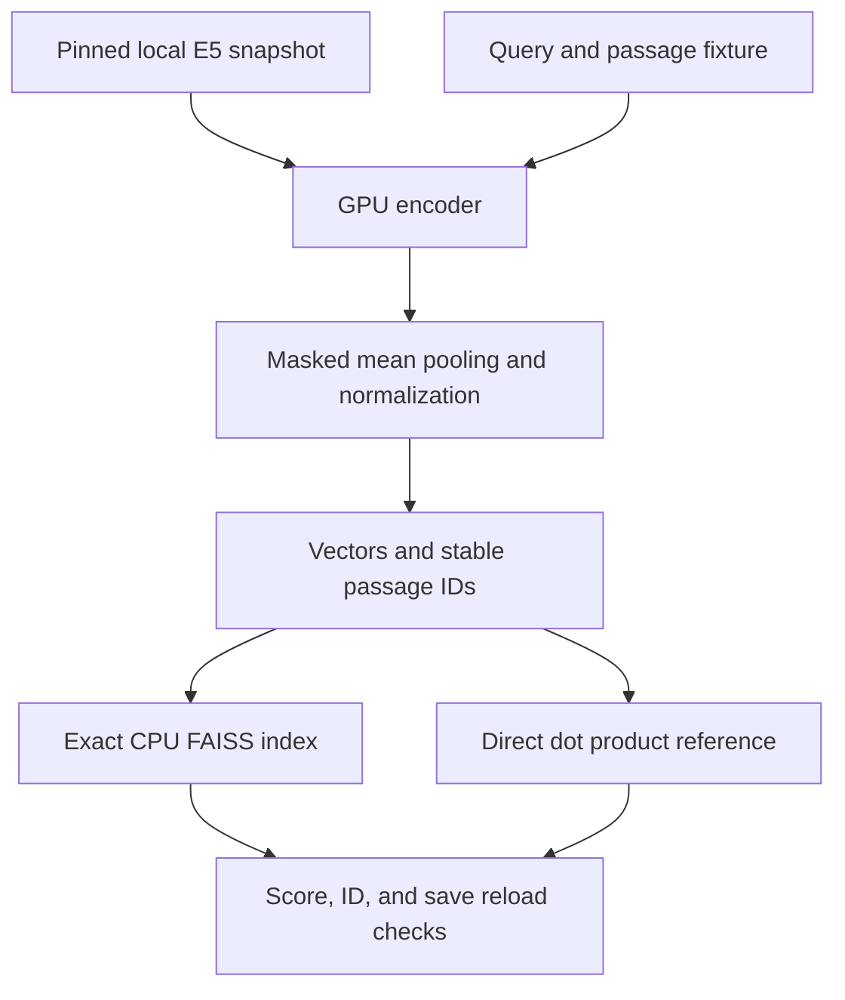

# Learning to Rank and Retrieval Optimization System

A reproducible passage retrieval and ranking project studying model quality, indexing, and serving efficiency on Slurm-managed GPUs.

**Status:** data ingestion, query splitting, full-corpus BM25 indexing/retrieval, and binary evaluation are verified on NYU HPC. E5 encoding and exact FAISS smoke checks pass; a larger encoding pilot is implemented but has not run. Dense corpus retrieval, training, ANN, reranking, and serving remain planned. See [measured results](docs/results.md) and the [validation record](docs/validation.md).

## Architecture overview

Implemented correctness path:



See [System design](docs/design.md) for the planned retrieval/reranking pipeline, training and evaluation flow, and execution boundaries.

## Implemented and planned scope

| Component | Current state |
| --- | --- |
| Pinned E5 checkpoint download | Implemented and verified on HPC |
| Offline GPU encoder with masked mean pooling | Implemented and verified on L40S |
| Exact CPU FAISS and stable passage IDs | Implemented; score, ID, and reload checks passed |
| Runtime validation and atomic JSON metadata | Implemented |
| Unit tests, linting, CPU CI configuration | 58 local tests pass; initial GitHub CI passed; new changes await CI |
| MS MARCO ingestion and query splits | Verified; 50,000 training / 2,000 validation queries |
| Full-corpus BM25 | 8,841,823 passages indexed; validation baseline measured |
| Binary metrics and file evaluator | Implemented; 12 evaluator tests also passed on HPC |
| Dense encoding pilot | Implemented and locally checked; GPU execution pending |
| ANN, model training, reranker, serving | Planned |

## Repository layout

| Path | Responsibility |
| --- | --- |
| `src/ltr_system/` | Data preparation, lexical retrieval, evaluation, encoding, and integrity checks |
| `src/ltr_system/defaults/` | Versioned model identity and illustrative input fixture |
| `scripts/` | Thin CLI wrappers supporting Python isolated mode |
| `tests/` | CPU correctness, error cases, and CLI checks |
| `slurm/` | Short GPU smoke-test submission template |
| `requirements/` | Dependency inputs, constraints, and directly observed versions |
| `docs/` | Architecture, decisions, evaluation protocol, and runbooks |
| `.github/workflows/` | Automated lint, formatting, and CPU tests |

Runtime datasets, caches, logs, environments, checkpoints, and indexes are excluded from Git.

## Quick start

Use the dedicated project environment; do not install into shared Conda base. See [HPC setup](docs/runbooks/hpc_setup.md) for the verified environment and migration procedure. Commands below run from a source checkout containing both `scripts/` and `src/`:

```bash
python -I scripts/download_encoder.py --help
python -I scripts/faiss_exact_check.py --help
```

Every command accepts `--project-root` and `--log-level`. Runtime root precedence is explicit CLI argument, `LTR_PROJECT_ROOT`, `$SCRATCH/learning-to-rank`, then the current directory. The GPU commands require a valid Slurm allocation. The three-vector CPU search check does not require a GPU. A source checkout can use these wrappers without installing the package; an editable installation is useful for tests.

Transfer `src/` with `scripts/` when updating an HPC checkout. Keep environments and runtime artifacts outside source transfers.

## Documentation

- [Documentation index](docs/README.md)
- [Architecture and theory](docs/architecture.md)
- [System design diagrams](docs/design.md)
- [Evaluation protocol](docs/evaluation.md)
- [Reproducibility contract](docs/reproducibility.md)
- [Development and review](CONTRIBUTING.md)
- [HPC runbook](docs/runbooks/hpc_setup.md)
- [Git workflow](docs/runbooks/git_workflow.md)
- [Validation record](docs/validation.md)

A repository license has not yet been selected.
