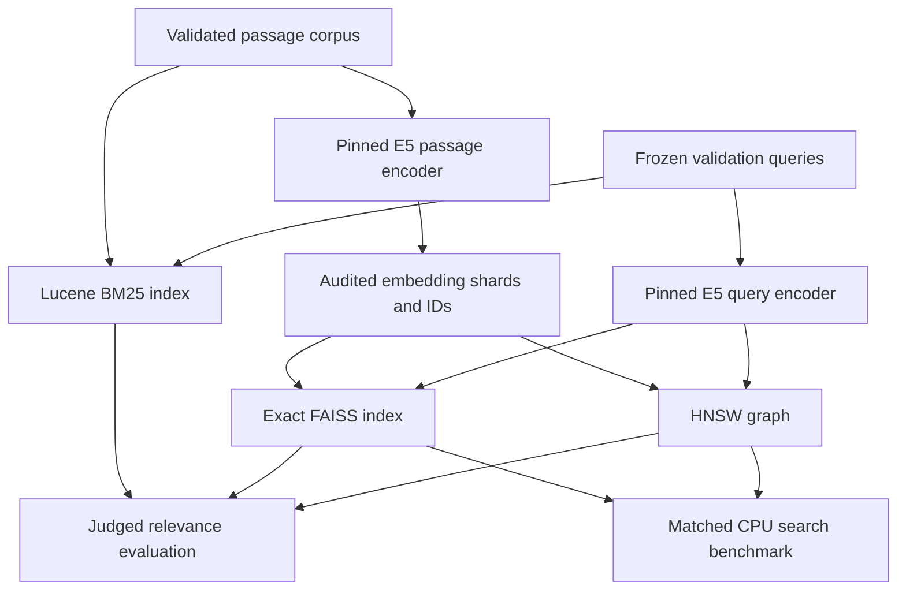

# Learning to Rank and Retrieval Optimization System

A reproducible passage retrieval and ranking project studying model quality, indexing, and serving efficiency on Slurm-managed GPUs.

**Status:** full-corpus BM25, pretrained E5 exact retrieval and HNSW retrieval are measured over 8,841,823 passages on NYU HPC. The data pipeline, frozen query splits, resumable encoding and index verification are implemented. BM25 and exact relevance metrics agree with an independent evaluator. A repeated CPU benchmark measures the HNSW speed–quality tradeoff. Model training, neural reranking and serving remain planned. See [measured results](docs/results.md) and the [validation record](docs/validation.md).

## Architecture overview

Implemented offline experiment path:



See [System design](docs/design.md) for the planned retrieval/reranking pipeline, training and evaluation flow, and execution boundaries.

## Implemented and planned scope

| Component | Current state |
| --- | --- |
| Pinned E5 checkpoint download | Implemented and verified on HPC |
| Offline GPU encoder with masked mean pooling | Implemented and verified on L40S |
| Exact CPU FAISS and stable passage IDs | Implemented; score, ID, and reload checks passed |
| Runtime validation and atomic JSON metadata | Implemented |
| Unit tests, linting, CPU CI configuration | Automated CPU checks; latest ANN/reporting changes await CI |
| MS MARCO ingestion and query splits | Verified; 50,000 training / 2,000 validation queries |
| Full-corpus BM25 | 8,841,823 passages indexed; validation baseline measured |
| Binary metrics and file evaluator | Implemented; 12 evaluator tests also passed on HPC |
| Dense encoding | All 89 shards audited; 8,841,823 vectors at 384 dimensions |
| Full-corpus exact E5 | Validation baseline measured; independent metric agreement passed |
| HNSW | Full graph verified; efSearch 1024/2048/4096 evaluated |
| Matched CPU search benchmark | Four repetitions; batch throughput and single-query search p50/p95 |
| Model training, reranker, serving | Planned |

## Measured indexing tradeoff

On one CPU node with four threads, batch size 32 and top 1,000 retrieval,
HNSW efSearch=2048 reached 415.20 median batch queries/sec versus 4.23
for exact search across four repetitions. Single-query search p95 was
12.64 ms versus 547.98 ms. Judged Recall@1000 on 2,000 validation queries
was 0.96025 versus 0.96850. The model is an existing pretrained checkpoint;
these are indexing results, not gains from project-specific training.

These measurements exclude query encoding, queueing, networking and
reranking. See the [benchmark figures and reproduction instructions](docs/benchmark_figures.md)
for trial variability, hardware and scope.

## Repository layout

| Path | Responsibility |
| --- | --- |
| `src/ltr_system/` | Data preparation, lexical retrieval, evaluation, encoding, and integrity checks |
| `src/ltr_system/defaults/` | Versioned model identity and illustrative input fixture |
| `scripts/` | Thin CLI wrappers supporting Python isolated mode |
| `tests/` | CPU correctness, error cases, and CLI checks |
| `slurm/` | Short GPU smoke-test submission template |
| `requirements/` | Dependency inputs, constraints, and directly observed versions |
| `docs/` | Architecture, decisions, evaluation protocol, and runbooks |
| `.github/workflows/` | Automated lint, formatting, and CPU tests |

Runtime datasets, caches, logs, environments, checkpoints, and indexes are excluded from Git.

## Quick start

Use the dedicated project environment; do not install into shared Conda base. See [HPC setup](docs/runbooks/hpc_setup.md) for the verified environment and migration procedure. Commands below run from a source checkout containing both `scripts/` and `src/`:

```bash
python -I scripts/download_encoder.py --help
python -I scripts/faiss_exact_check.py --help
```

Every command accepts `--project-root` and `--log-level`. Runtime root precedence is explicit CLI argument, `LTR_PROJECT_ROOT`, `$SCRATCH/learning-to-rank`, then the current directory. The GPU commands require a valid Slurm allocation. The three-vector CPU search check does not require a GPU. A source checkout can use these wrappers without installing the package; an editable installation is useful for tests.

Transfer `src/` with `scripts/` when updating an HPC checkout. Keep environments and runtime artifacts outside source transfers.

## Documentation

- [Documentation index](docs/README.md)
- [Architecture and theory](docs/architecture.md)
- [System design diagrams](docs/design.md)
- [Evaluation protocol](docs/evaluation.md)
- [Reproducibility contract](docs/reproducibility.md)
- [Development and review](CONTRIBUTING.md)
- [HPC runbook](docs/runbooks/hpc_setup.md)
- [Git workflow](docs/runbooks/git_workflow.md)
- [Validation record](docs/validation.md)

A repository license has not yet been selected.
