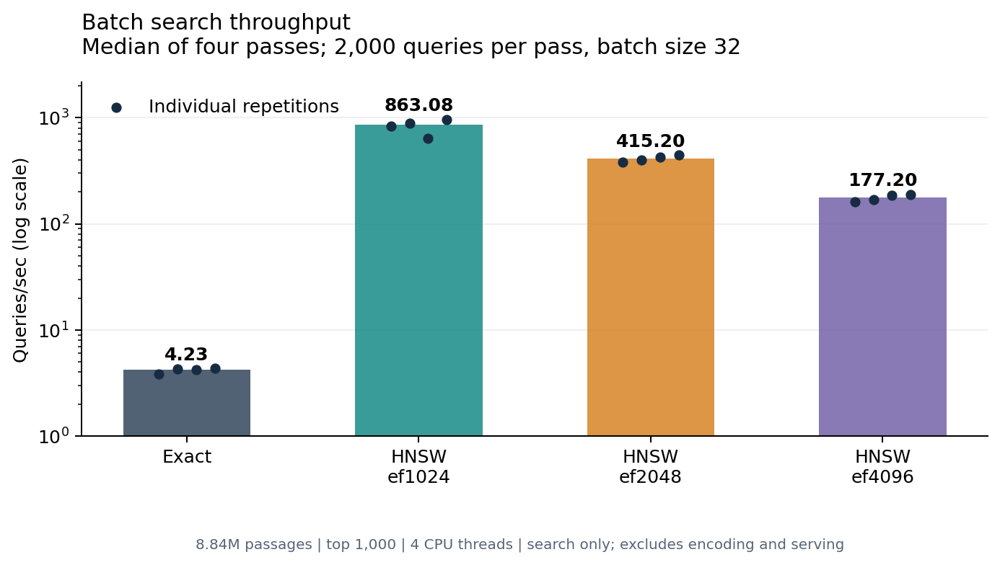
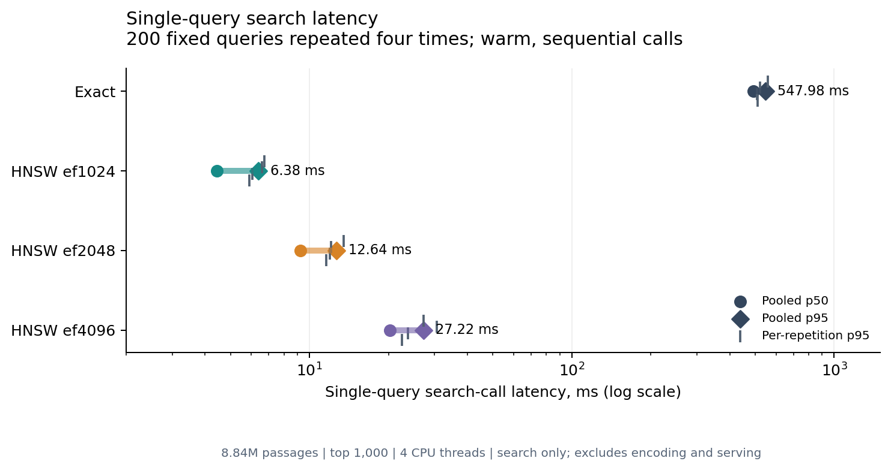
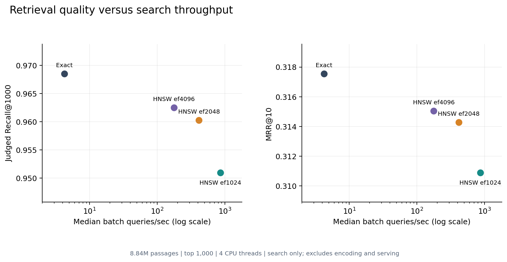

# Search benchmark figures

These figures use the saved matched benchmark and the separately measured
validation relevance reports. The generator recomputes timing summaries
from raw observations and checks index/query identities against the quality
runs before plotting. The portable summary records input hashes and
configuration without local paths or query IDs.

## Batch throughput



Bars show median queries/second across four passes of 2,000 queries, with
batch size 32 and top 1,000 candidates. Dots are individual measured passes,
not confidence intervals. The vertical scale is logarithmic. All indexes
were resident in one process on the same node, with four CPU threads.

## Single-query search latency



Circles and diamonds show pooled p50 and p95 across four repetitions of
the same 200-query sample. Small marks show per-repetition p95. The
horizontal scale is logarithmic. These are actual sequential one-query
search calls, not batch time divided by batch size. Repeated observations
of the same sample are not independent users. The benchmark excludes query
encoding, network, queueing, document lookup and reranking.

## Quality versus throughput



Quality is measured over all 2,000 frozen validation queries. Throughput
comes from the matched benchmark; checksums bind both sets of reports to
the same index and query artifacts. Y axes focus on the measured range
rather than starting at zero. No quality confidence intervals are shown.
Final evaluation queries remain reserved.

The ef2048 configuration is a working candidate: 98.07 times the exact
batch throughput with judged Recall@1000 lower by 0.00825, or 0.825
percentage points. ef4096 recovers more exact neighbors and relevant
passages but has lower throughput. A final choice also depends on reranker
candidate depth; serving-level performance has not been measured.

## Hardware and variability

The benchmark ran on an Intel Xeon Platinum 8592+ node, with affinity to
four CPU IDs, FAISS 1.15.1 and NumPy 2.2.6. OMP, OpenBLAS and MKL thread
limits were four. Algorithm trial position was balanced across four
repetitions, using common query orders and explicit warmup. The node was
not exclusively reserved. Both indexes remained resident.

ef2048 throughput ranged from 383.57 to 445.90 queries/sec across trials;
its per-repetition search p95 ranged from 11.61 to 13.50 ms. Variability
and ordered drift are visible; this experiment does not isolate their
cause. Process peak RSS and Slurm MaxRSS differ and cover different
accounting observations. Neither is an isolated per-index memory measure.

## Reproduction

Install optional plotting dependencies in a local project environment:

```bash
python -m pip install -r requirements/plotting.txt
```

With the downloaded raw benchmark and extracted quality reports present:

```bash
python -I scripts/plot_search_benchmark.py --project-root .
```

The command defaults to `artifacts/transfers/search-matched-v1.json` and
`artifacts/reports/hnsw-quality/`. It creates PNG/SVG figures, a public
`summary.json` with source hashes and trial summaries, and `summary.csv`
under `docs/figures/search-v1/`. It refuses to overwrite an existing output
directory; use `--output` with a new directory for a repeat rendering.
Raw reports remain Git-ignored. Figures and the derived summary can be
reviewed and committed with the rendering code.
