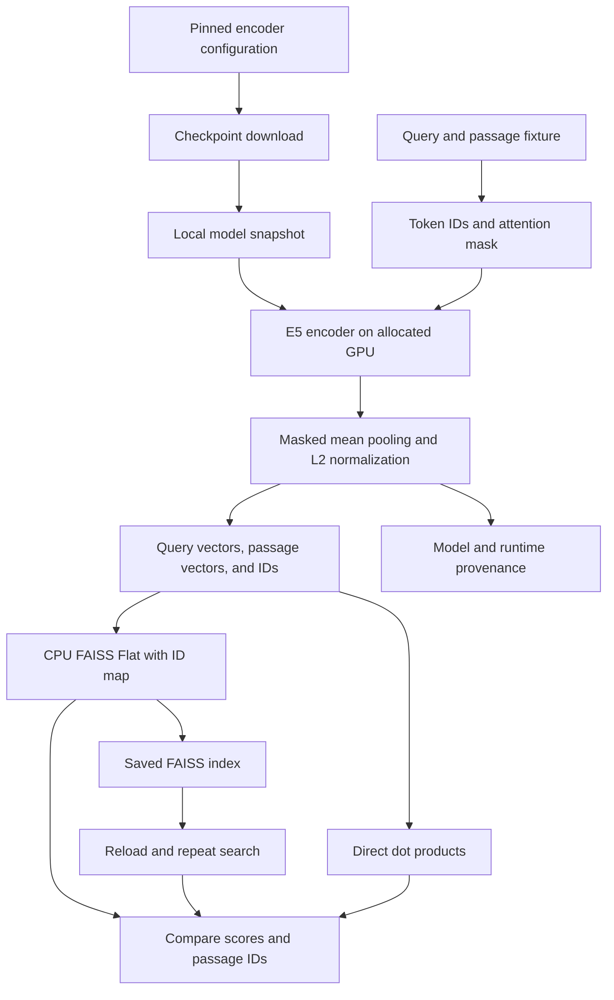
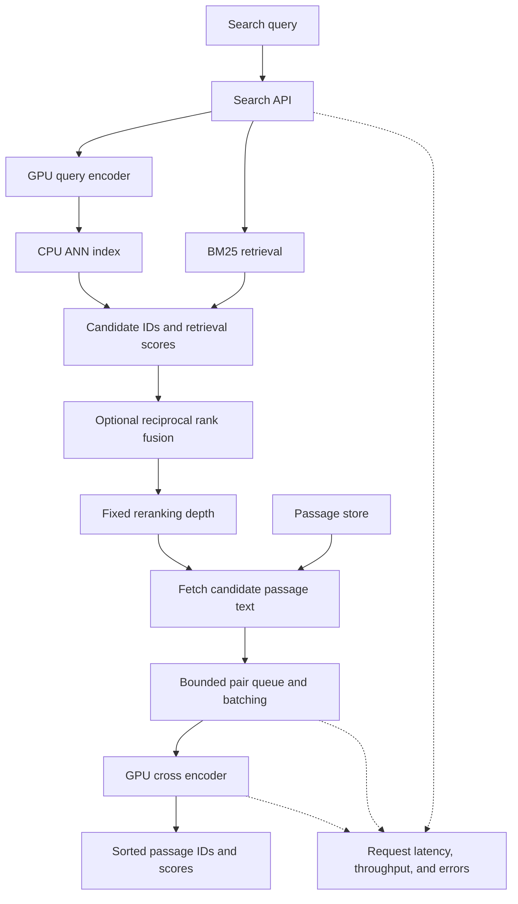
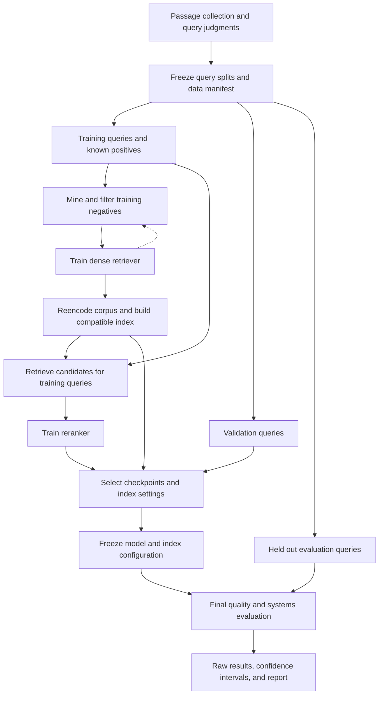
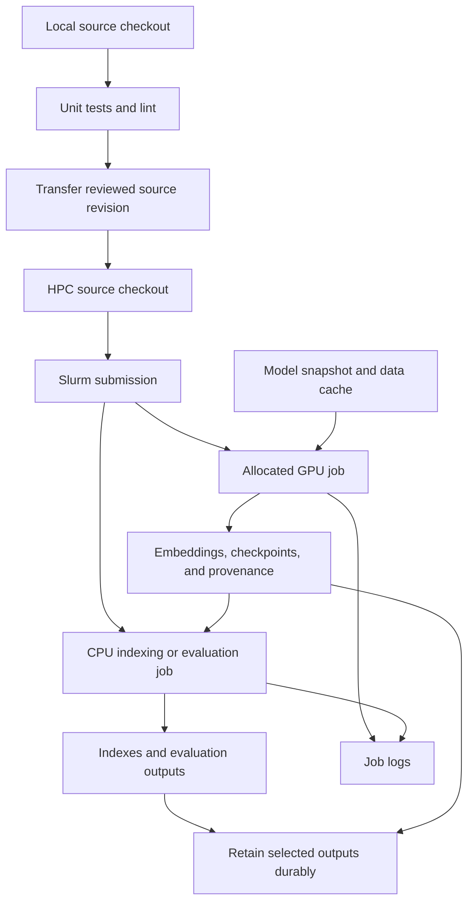

# System design

The diagrams distinguish implemented correctness checks from the planned retrieval system. Solid arrows show data flow; dashed arrows show a dependency or feedback path.

## Implemented encoder and index checks

This path uses the fixture in `src/ltr_system/defaults/smoke_inputs.json`: one query and three passages. It does not use a benchmark corpus or serve requests.

`IndexFlatIP` compares each query with every stored passage vector. The check accepts either ordering for tied scores, but each returned ID must match its reference score. Normalization makes the inner product equivalent to cosine similarity.

## Planned retrieval and reranking

All serving components below are planned. The encoder and exact-index checks establish primitives for this design, not an implemented online service.

BM25 and fusion are comparison paths rather than mandatory dependencies of dense-only retrieval. Start with a fixed reranking depth; adaptive budgeting is a later experiment. The passage store resolves stable IDs to text. A relevant passage omitted from the candidate set cannot be recovered by the reranker.

The bounded queue limits pending inference work. End-to-end latency must include queue wait, tokenization, retrieval, passage lookup, and reranking. The initial serving target is a single allocated host; the diagram does not imply a distributed deployment.

## Planned training and evaluation

Training and validation queries drive model selection. Final evaluation queries remain outside mining, fitting, and parameter selection. The passage collection may be shared across query splits; judgments must retain their split roles.

The mining feedback path is restricted to training queries. Exclude known positives and filter likely false negatives. Validation candidates are used only for selection. Reranker comparisons use identical saved candidates to isolate changes in ranking. A retriever update requires compatible corpus embeddings and an index.

## Execution and storage

The local source tree is versioned with Git. HPC storage holds checkpoints, caches, environments, vectors, and indexes; these runtime directories are excluded from source control.

GPU smoke jobs and the local source layout are implemented. Corpus indexing, training, and full evaluation jobs remain planned. Downloads and package installation happen before GPU allocation. Scratch is working storage; source and expensive outputs require a durable copy.

## Artifact compatibility

| Artifact | Identity required for reuse |
| --- | --- |
| Encoder checkpoint | Model repository and immutable revision |
| Passage embeddings | Encoder identity, pooling, normalization, truncation, corpus manifest, and passage IDs |
| Vector index | Embedding identity, similarity metric, index parameters, and ID mapping |
| Reranker checkpoint | Base checkpoint, training split, negative/candidate generation, and objective |
| Evaluation run | Code revision, frozen configuration, query split, judgments, hardware, and load profile |

The checkpoint manifest and smoke-test provenance are implemented. Corpus-scale manifests, reranker metadata, and experiment records will be added with their pipelines.
